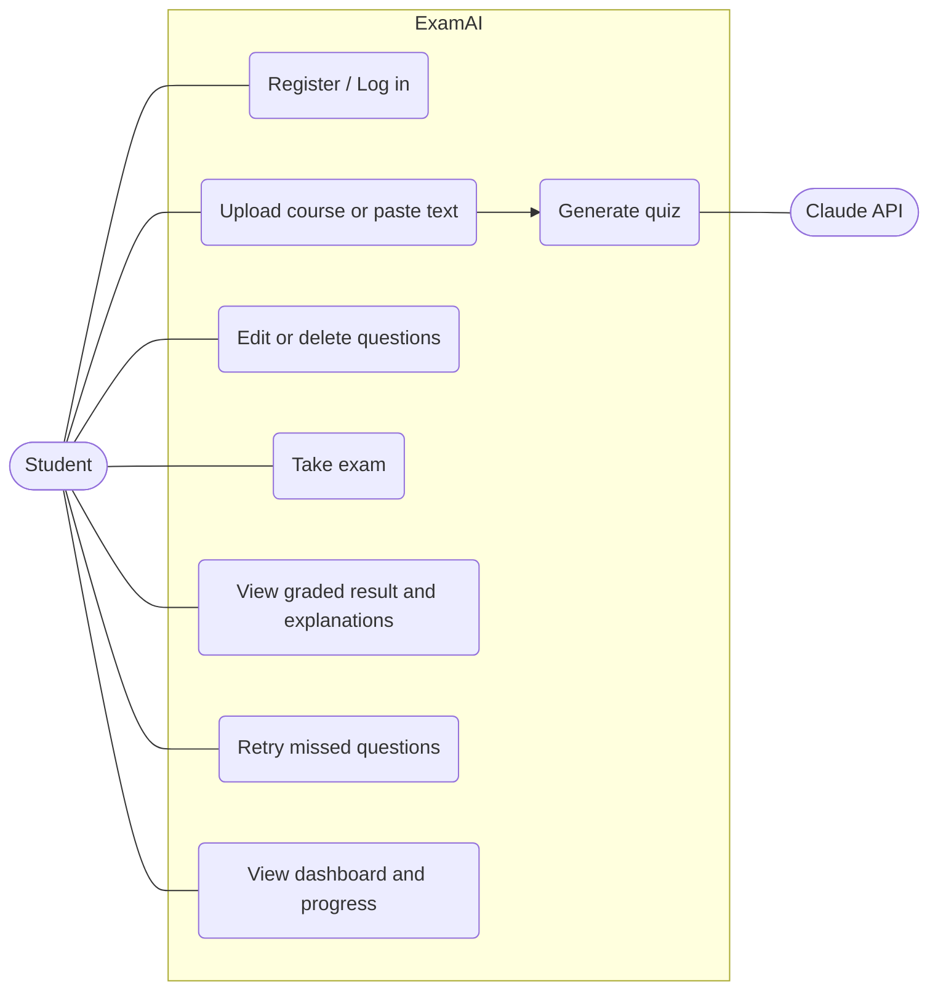
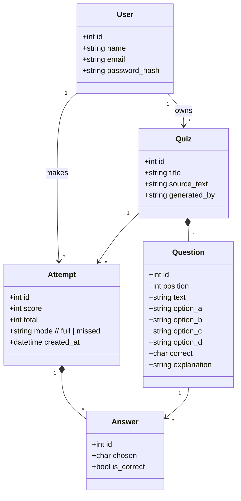
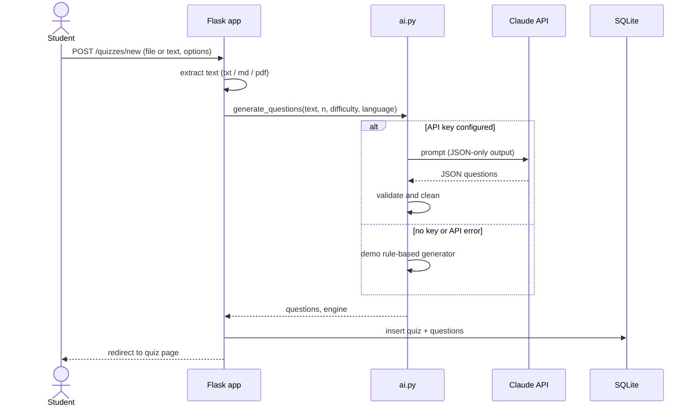
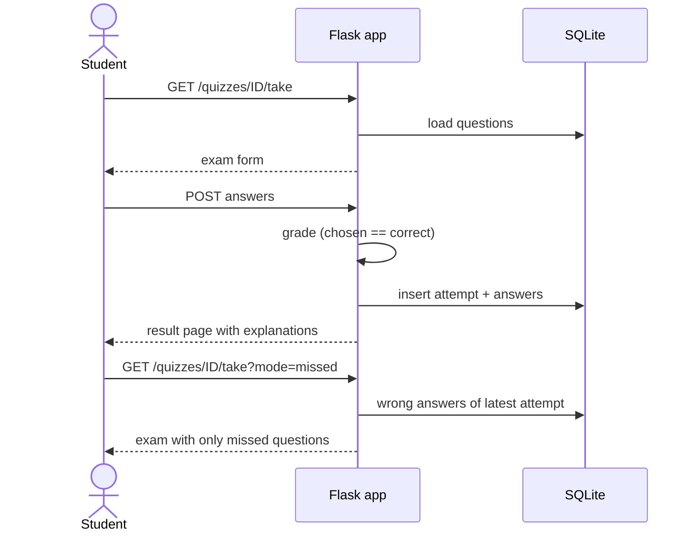
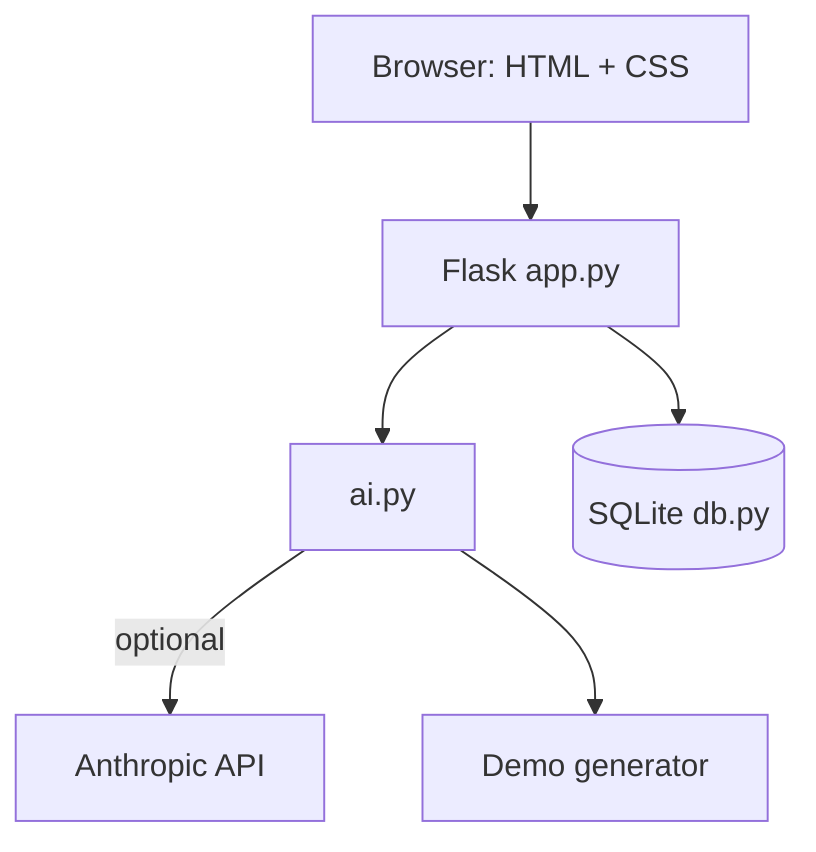

# UML Diagrams

Diagrams use Mermaid (rendered automatically by GitHub).

## Use case diagram

## Class / data model diagram

## Sequence diagram: generate a quiz

## Sequence diagram: take an exam and retry missed questions

## Architecture

